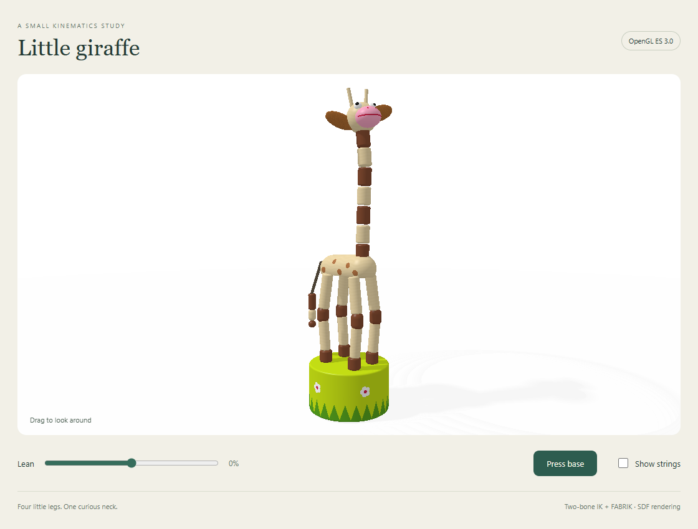

# tinyik

A little math, a long neck, and four wooden legs. Single-header C++23 and
dependency-free Rust inverse kinematics, with an OpenGL ES 3.0 / WebGL 2 giraffe.

[Live demo](https://varnholt.github.io/tinyik/) · [Rust demo](https://varnholt.github.io/tinyik/?core=rust) · [C++ demo](https://varnholt.github.io/tinyik/?core=cpp)



The core provides analytic **two-bone IK** with a pole point and elbow bend
limits, and **FABRIK** for longer chains with optional minimum/maximum bend
angles at interior joints. It operates on 3D positions; use `z = 0` and a pole
in the same plane for a 2D chain. Both implementations use `double` / `f64`.

No renderer, windowing library or other dependencies are required by either
core. Solving performs no heap allocations. The caller owns the joint arrays,
targets and timing. The browser compiles the real C++ and Rust implementations
to WebAssembly; there is no JavaScript copy of the solver.

## C++23

Copy [include/tinyik/tinyik.hpp](include/tinyik/tinyik.hpp) into your project,
or link against `tinyik::tinyik` through CMake.

```cpp
#include <tinyik/tinyik.hpp>

// Two one-unit links reach (1, 1, 0). The pole chooses the knee side.
auto arm = tinyik::two_bone({0,0,0}, {1,1,0}, {1,0,0}, 1.0, 1.0);
if (arm) {
    auto knee = arm->joints[1];
    auto hand = arm->joints[2];
    // Use these positions in your renderer.
}
```

For a longer chain:

```cpp
std::array<tinyik::Vec3,4> joints{
    tinyik::Vec3{0,0,0}, {0,1,0}, {0,2,0}, {0,3,0}
};
std::array<double,3> lengths{1,1,1};
std::array<tinyik::BendLimit,2> limits{
    tinyik::BendLimit{0, tinyik::pi/2}, {0, tinyik::pi/2}
};

auto result = tinyik::fabrik(joints, lengths, {1,2,0}, {}, limits);
if (result) {
    // joints now contains the solved positions.
    // Check result->status and result->error to see how closely it reached.
}
```

All angles are radians: **0 means straight; pi means folded back**. FABRIK
limits the angle between consecutive segment directions, rather than an angle
against a global axis. Supply one limit per interior joint, or an empty span
for unrestricted bends. These are ball-joint bend limits; hinge axes, twist,
end-effector orientation and collision constraints are outside this version.

```sh
cmake -S . -B build -DCMAKE_BUILD_TYPE=Release
cmake --build build --config Release
ctest --test-dir build -C Release --output-on-failure
```

Requires CMake 3.25+ and a C++23 compiler/library supporting `std::expected`.
CI checks GCC 14 on Linux and MSVC on Windows. Examples/tests default on only
for a top-level build. `cmake --install build --config Release --prefix <path>`
installs the header and a `find_package(tinyik CONFIG REQUIRED)` package.

## Rust

The crate is in this repository; it has not been published to crates.io.

```toml
[dependencies]
tinyik = { git = "https://github.com/varnholt/tinyik", tag = "v0.1.0" }
```

```rust
use tinyik::{two_bone, BendLimit, Vec3};

let arm = two_bone(
    Vec3::new(0.0, 0.0, 0.0),
    Vec3::new(1.0, 1.0, 0.0),
    Vec3::new(1.0, 0.0, 0.0),
    1.0, 1.0, BendLimit::default(),
)?;
let hand = arm.joints[2];
```

Requires Rust 1.85+ with `std`. See [the Rust guide](rust/README.md).

```sh
cargo test --locked
cargo fmt --all -- --check
cargo clippy --locked --all-targets -- -D warnings
node scripts/check-parity.mjs
```

The last command compares C++ and Rust joint coordinates after building the
C++ examples. Tests cover reachable/unreachable targets, coincident and
collinear configurations, fixed segment lengths, bend limits and rejection
of invalid input. Cross-language coordinates are compared with tolerances;
bit-for-bit agreement across toolchains is not promised.

## Giraffe playground

Use **Lean**, **Press base**, **Show strings**, and drag to orbit. The **Core**
selector switches between C++ and Rust WASM using the same GLSL ES 3.00 shader.
The shader draws rounded wooden pieces between supplied joints; it does not
solve IK. The seven visible neck beads follow a four-link neck chain.

To build the Rust core locally:

```sh
rustup target add wasm32-unknown-unknown
python scripts/build-web.py
python -m http.server --directory web 8080
```

Open `http://localhost:8080`. Rust is the default. To also enable C++, activate
an Emscripten SDK (CI uses 7.0.0) and run:

```sh
em++ bindings/wasm.cpp -std=c++23 -Iinclude -O2 --no-entry -sSTANDALONE_WASM=1 -Wl,--export=pose -Wl,--export=joints_ptr -o web/tinyik-cpp.wasm
node tests/wasm.mjs
node tests/browser.mjs
```

The browser check requires Node 22+ and an installed Chrome; set `CHROME_PATH`
if it is not at the default location. It starts a temporary local static server,
checks compiled-core pose changes, shader compilation, GL errors, controls and
mobile layout, and writes screenshots to `build/screenshots`. `--rust-only`
checks a local build without Emscripten. CI runs both cores and deploys GitHub
Pages only after native and browser checks pass.

The giraffe's design follows a [House of Marbles wooden push-up toy](https://shop.houseofmarbles.com/wp-content/uploads/2019/05/220072-Jiggling-Giraffe-Press-Up-2.jpg).
The reference photograph is not distributed. The press motion is authored target
animation with a small easing spring. Visible strings illustrate routing; there
is no tension, gravity, self-collision or full toy-mechanism simulation.

## Solver contracts

- Input validation returns `std::expected` / `Result`. Invalid FABRIK input
  leaves all caller joint positions unchanged.
- A valid solve may return `converged`, `unreachable`, `limited` (analytic
  two-bone limits), or `iteration_limit`. A successful API call does not by
  itself mean the target was reached. Read the status and final tip distance.
- FABRIK fixes the root and restores all segment lengths in each forward pass.
  Constraints are enforced during that pass. It is iterative and can stop at
  a local solution. It does not prove that a constrained target is impossible.
- Default FABRIK budget: 64 iterations, tip tolerance `1e-5` world units.
  The demo uses 24 iterations and `0.0001` tolerance for the neck.
- Lengths must be finite and in `[1e-6, 1e6]`; coordinate and pole components
  must be finite with magnitude at most `1e9`. Bend limits must satisfy
  `0 <= min <= max <= pi`. Iteration budget: `[1, 10000]`; tolerance: `(0, 1e6]`.
  Use consistent, reasonably scaled world units for good numerical precision.
- The two-bone pole is a world-space point. FABRIK's option `pole` is a direction
  used to resolve ambiguous bend planes. Collinear poles use a stable fallback.
  At a coincident root/target, the fallback reach axis is +Y.
- Core state is entirely caller-owned. WASM demo adapters each have one static
  output buffer per module instance; consume its float view before another
  pose call or memory growth. C++ and Rust adapters pack the same 51 floats.

MIT licensed. Version 0.1.0 keeps the API small and the algorithms readable.
